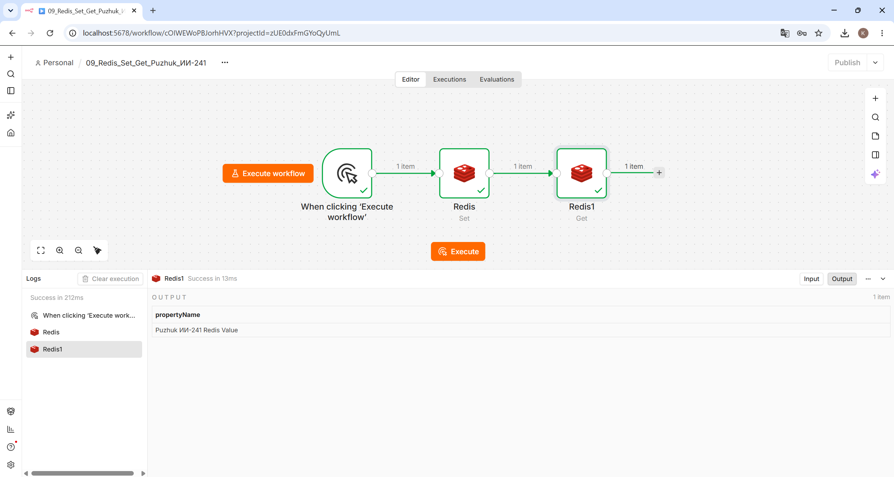
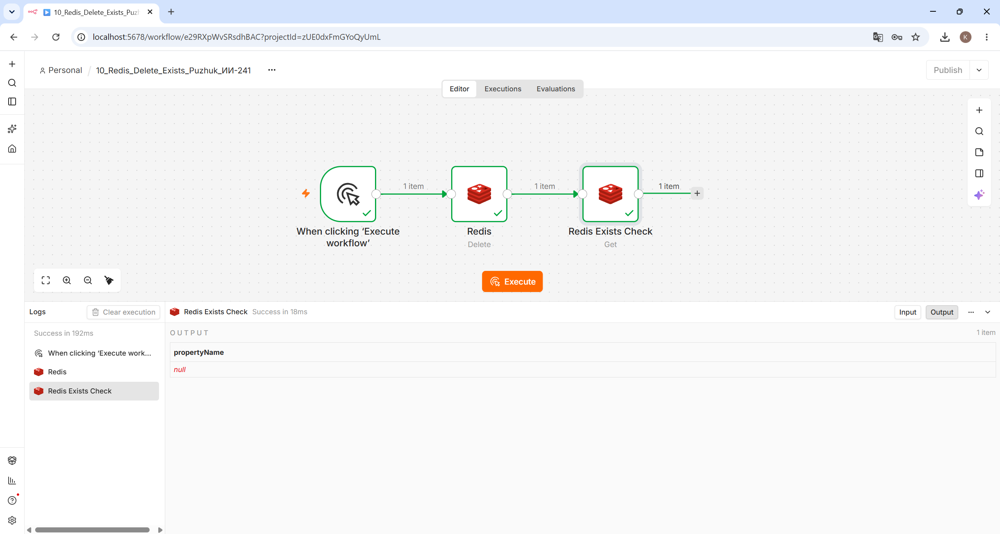

# Работа с Redis в n8n (Лабораторная работа №4)

**Студент:** Пужук (Puzhuk), группа ИИ-241

## 1. Установка и запуск Redis
Контейнер Redis был запущен в Docker с пробросом стандартного порта 6379:
`docker run -d --name redis -p 6379:6379 redis:7`

## 2. Настройка подключения (Credentials) в n8n
Поскольку n8n также работает внутри Docker-контейнера, для обращения к хост-машине в настройках Redis Credentials были указаны параметры:
- **Host:** `host.docker.internal`
- **Port:** `6379`

## 3. Описание созданных Workflow

### Workflow 1: Создание и чтение ключа (`flow-09-redis.json`)
1. **Manual Trigger** — ручной запуск сценария.
2. **Redis (Set)** — записывает в БД ключ `puzhuk` со строковым значением `"Puzhuk ИИ-241 Redis Value"`.
3. **Redis (Get)** — читает значение по ключу `puzhuk` и выводит его в поле `propertyName`.

### Workflow 2: Удаление и проверка отсутствия ключа (`flow-10-redis.json`)
1. **Manual Trigger** — ручной запуск сценария.
2. **Redis (Delete)** — удаляет ключ `puzhuk` из Redis.
3. **Redis (Get / Exists check)** — выполняет попытку чтения ключа `puzhuk` после удаления. Возвращает `null`, что подтверждает отсутствие ключа в базе данных.

