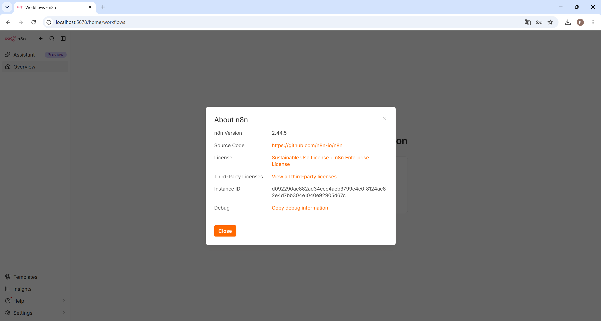
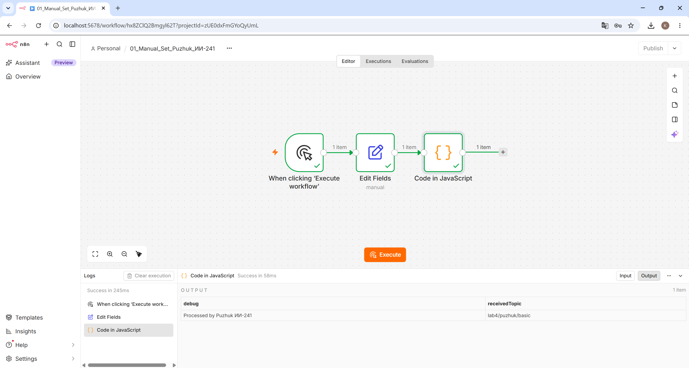
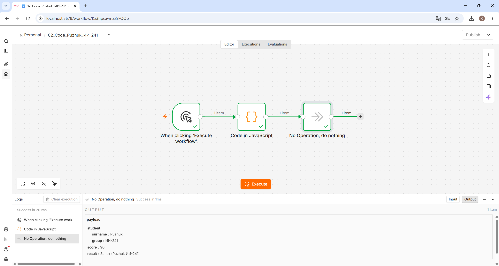
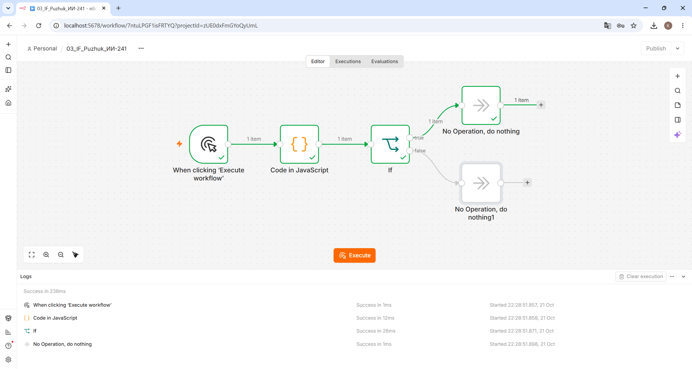
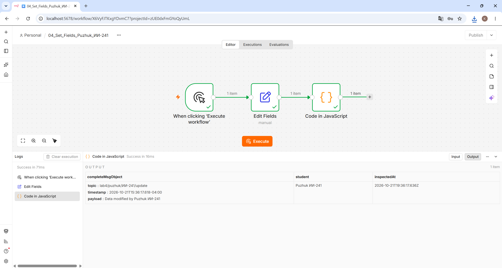
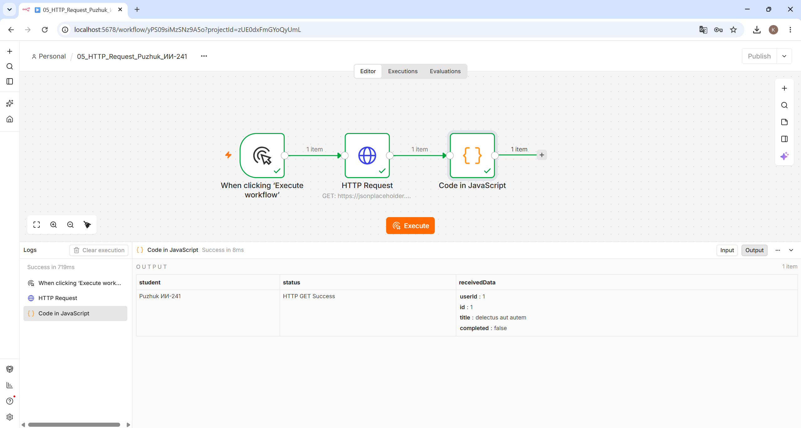
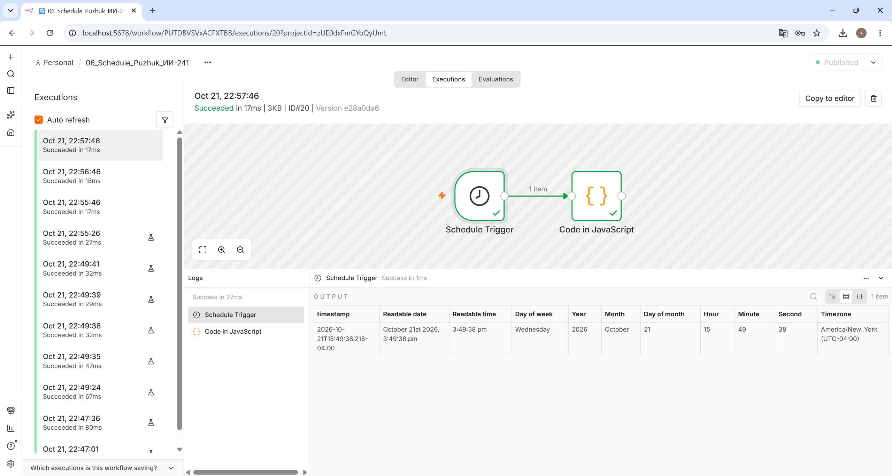
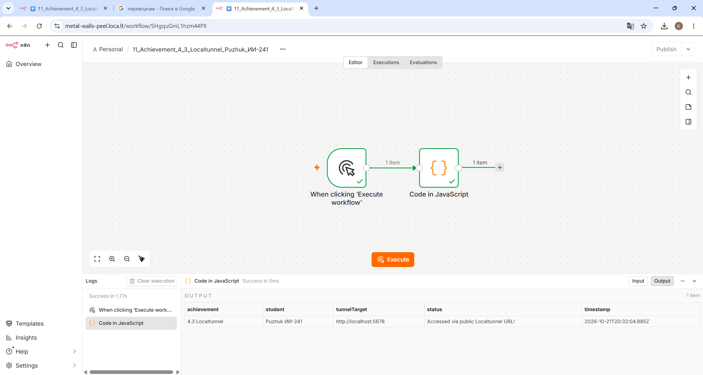

# Отчёт по лабораторной работе №4. n8n

**Студент:** Пужук (Puzhuk)  
**Группа:** ИИ-241  

---

## 1. Краткое описание выполненной работы

### Часть 1. Установка и запуск n8n через Docker
Платформа автоматизации n8n была развёрнута в Docker-контейнере из официального образа `n8nio/n8n` на порту `5678`. При запуске были примонтированы два локальных тома (`volume`):
- `~/n8n-docker/n8n_data:/home/node/.n8n` — для сохранения конфигурации, учётной записи и созданных workflow;
- `~/n8n-docker/shared_data:/data` — для работы с пользовательскими файлами внутри контейнера.

Команда запуска контейнера в Git Bash:
    MSYS_NO_PATHCONV=1 docker run -d --restart unless-stopped --name n8n -p 5678:5678 --dns 77.88.8.8 --dns 8.8.8.8 -e TZ="Europe/Moscow" -e N8N_ENFORCE_SETTINGS_FILE_PERMISSIONS=true -v ~/n8n-docker/n8n_data:/home/node/.n8n -v ~/n8n-docker/shared_data:/data n8nio/n8n

После запуска была пройдена регистрация владельца по адресу `http://localhost:5678`.

### Часть 2. Изучение базовых и продвинутых нод
Были разработаны, протестированы и экспортированы 6 базовых сценариев (workflow) с использованием индивидуальных данных (`Puzhuk ИИ-241`):
1. `flow-01-manual-set.json` — ручной запуск (`Manual Trigger`), задание полей `payload` и `topic` в ноде `Set` (`Edit Fields`) и отладочный вывод в `Code`.
2. `flow-02-code.json` — использование базовых конструкций JavaScript (`const/let`, `for`, `if/else`, массивов и объектов) в ноде `Code` с передачей в `NoOp`.
3. `flow-03-if.json` — условное ветвление (`IF`) по вычисленному значению внутри `payload` на ветки `true` и `false`.
4. `flow-04-set.json` — формирование полей `topic`, динамического времени `timestamp` (`$now.toISO()`) и `payload` с выводом полного объекта сообщения в `Code`.
5. `flow-05-http.json` — выполнение GET-запроса к публичному REST API (`https://jsonplaceholder.typicode.com/todos/1`) через `HTTP Request` и обработка JSON-ответа.
6. `flow-06-schedule.json` — периодический запуск сценария по расписанию (`Schedule Trigger`) с возвратом текущего времени.

### Часть 3. Работа с СУБД Redis
В Docker был развёрнут контейнер `redis:7` на порту `6379`. В n8n настроены `Credentials` через хост `host.docker.internal:6379`. Реализованы два сценария:
- `flow-09-redis.json` — создание ключа `puzhuk` (`Set`) и его чтение (`Get`).
- `flow-10-redis.json` — удаление ключа `puzhuk` (`Delete`) и проверка его отсутствия (`Get` возвращает `null`).
Подробное описание приведено в файле [redis.md](./redis.md).

### Часть 4. Индивидуальная ачивка 4.3 (Туннелирование через Localtunnel)
С помощью утилиты `localtunnel` (`npx -y localtunnel --port 5678`) был организован проброс локального порта `5678` во внешнюю сеть. Получен публичный HTTPS-адрес `https://metal-walls-peel.loca.lt`, пройдена авторизация по внешнему IP хоста и выполнен демонстрационный workflow `flow-11-localtunnel.json`.

---

## 2. Использованные AI-промпты (ключевые примеры)

1. **Промпт для запуска Docker в Git Bash на Windows:**
   > «Как запустить образ n8nio/n8n в Docker через Git Bash на Windows с пробросом порта 5678 и двумя volume (/home/node/.n8n и /data), чтобы Git Bash не искажал пути внутри контейнера?»
2. **Промпт для написания JS-логики в ноде Code:**
   > «Напиши код для ноды Code в n8n на JavaScript, который использует let/const, массив оценок, цикл for для подсчёта суммы, условие if/else и возвращает объект с полем payload для студента Puzhuk группы ИИ-241.»
3. **Промпт для диагностики DNS в Docker и настройки HTTP Request:**
   > «В n8n внутри Docker при запросе из HTTP Request возникает ошибка The DNS server returned an error. Как прописать публичные DNS-серверы при запуске контейнера и какой публичный JSON API использовать для теста?»
4. **Промпт для выполнения ачивки 4.3:**
   > «Как пробросить локальный порт 5678 контейнера n8n в интернет с помощью Localtunnel (npx localtunnel --port 5678) и пройти проверку Tunnel Password?»

---

## 3. Освоенные ноды n8n

- **Manual Trigger** — ручной запуск workflow для тестирования и отладки.
- **Edit Fields (Set)** — создание, изменение и маппинг полей JSON-объекта (включая вычисляемые выражения `Expressions`).
- **Code (JavaScript)** — написание пользовательской логики обработки элементов (`$input.first()`, `$input.all()`), логирование в консоль и формирование структуры выходных данных.
- **No Operation, do nothing (NoOp)** — пустой узел для завершения веток и визуальной структуризации схем.
- **If** — маршрутизация потока данных по веткам `true` / `false` на основе заданных условий.
- **HTTP Request** — отправка HTTP/HTTPS-запросов (GET/POST и др.) к внешним REST API и парсинг JSON-ответов.
- **Schedule Trigger** — автоматический запуск workflow по таймеру (интервалы в минутах/часах или cron-выражения).
- **Redis** — взаимодействие с резидентной базой данных типа «ключ-значение» (операции `Set`, `Get`, `Delete`).

---

## 4. Скриншоты всех разработанных Workflow

### 4.1. Установленная версия и интерфейс n8n

### 4.2. Workflow 1: Manual Trigger -> Set -> Code

### 4.3. Workflow 2: Code -> NoOp

### 4.4. Workflow 3: Условное ветвление IF

### 4.5. Workflow 4: Изменение полей в Set и полный объект сообщения

### 4.6. Workflow 5: Запрос к публичному API через HTTP Request

### 4.7. Workflow 6: Запуск по расписанию (Schedule Trigger)

### 4.8. Workflow 9: Redis — создание и чтение ключа

### 4.9. Workflow 10: Redis — удаление и проверка отсутствия ключа

### 4.10. Ачивка 4.3: Публичный доступ к n8n через Localtunnel

---

## 5. Выводы

В ходе выполнения лабораторной работы была освоена low-code платформа автоматизации **n8n**. Я научился разворачивать n8n и сопутствующие сервисы (СУБД **Redis**) в изолированных Docker-контейнерах с сохранением состояния через тома (`volumes`) и настройкой сетевого взаимодействия между контейнерами через `host.docker.internal`. 

Были изучены принципы передачи данных между узлами в формате массива JSON-элементов, работа с встроенными выражениями (`Expressions`), написание кастомных скриптов на JavaScript в ноде `Code`, интеграция с внешними REST API через `HTTP Request` и запуск фоновых задач по расписанию (`Schedule Trigger`). Кроме того, в рамках индивидуальной ачивки 4.3 было настроено туннелирование локального сервера во внешнюю сеть с помощью сервиса **Localtunnel**, что позволяет принимать внешние вебхуки и обращаться к локальному экземпляру n8n по публичному HTTPS-адресу.
