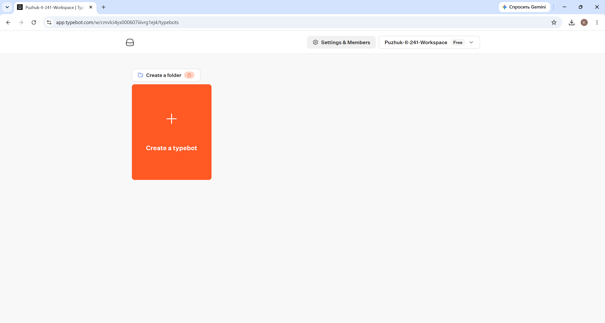
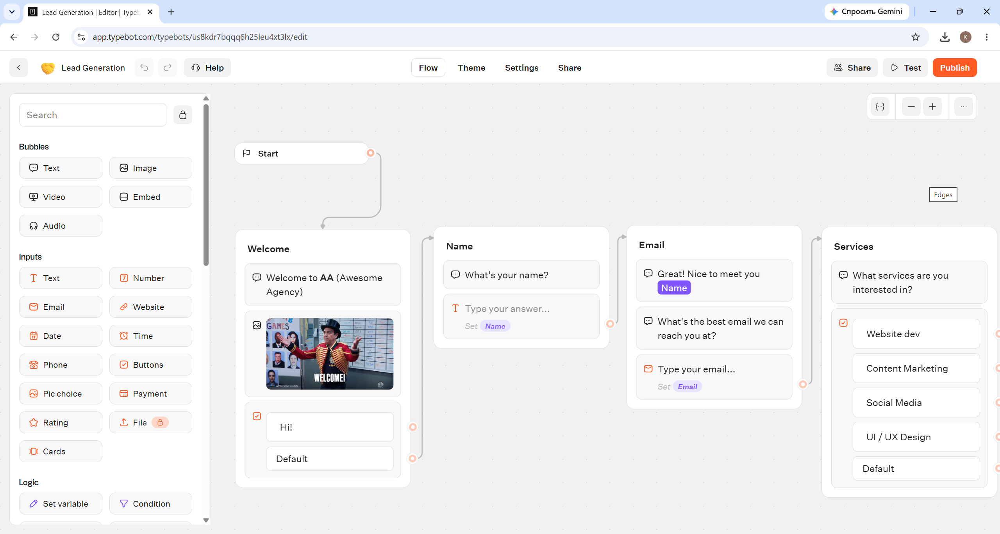
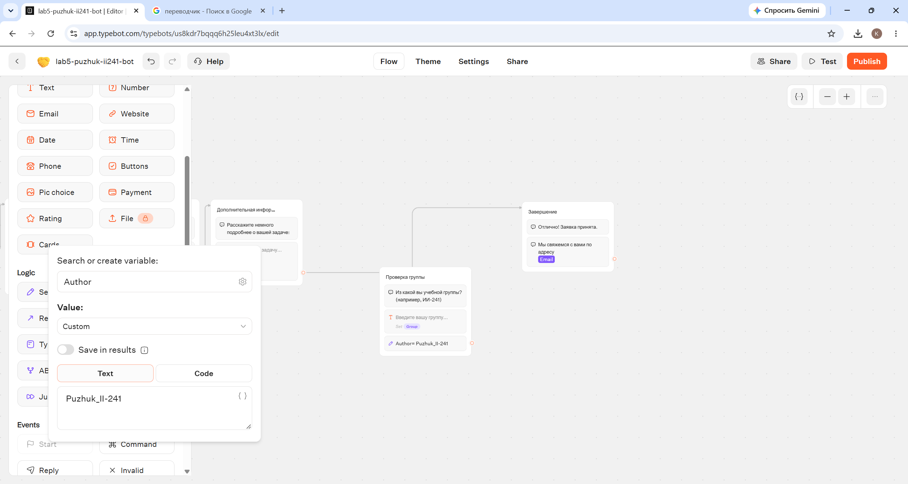
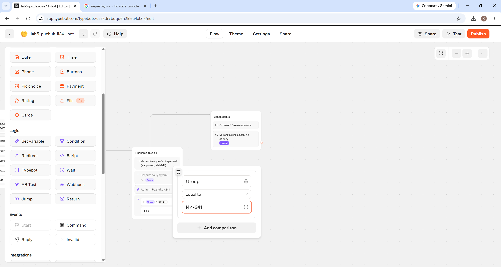
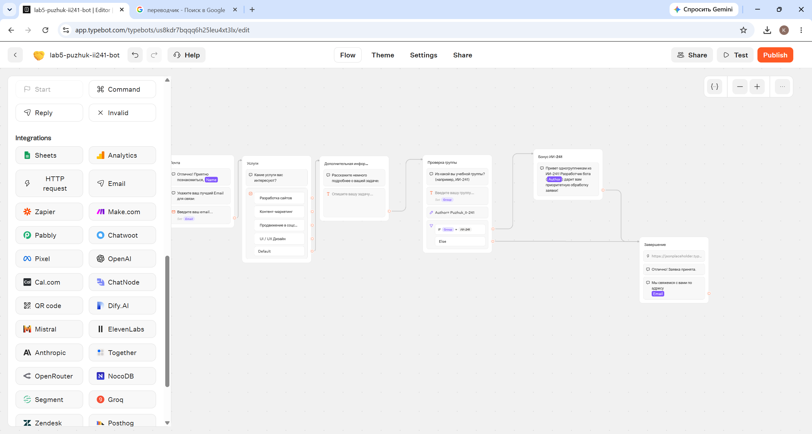
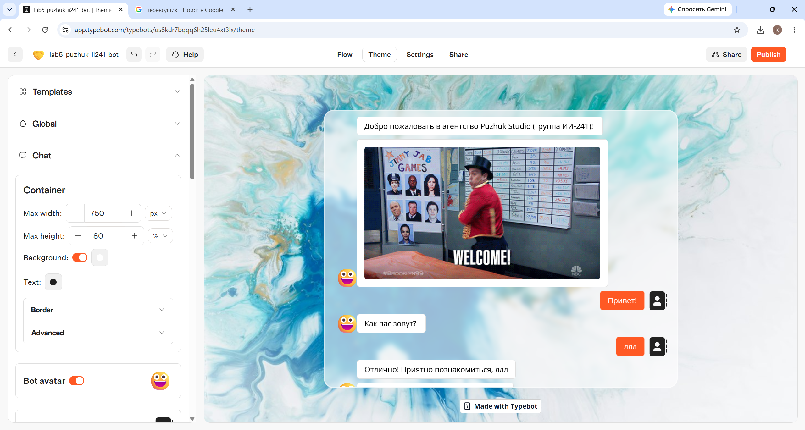
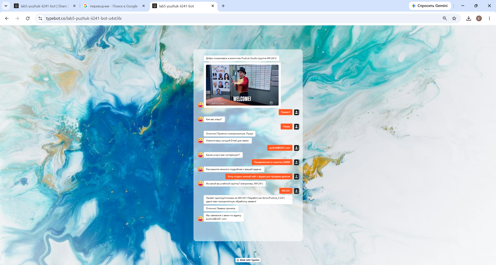

# Лабораторная работа №5. Чат-боты (Трек C: TypeBot)

**Студент:** Пужук (Puzhuk)  
**Группа:** ИИ-241  
**Трек:** C. TypeBot  

---

## 1. Краткое описание выбранного трека

В рамках лабораторной работы был выбран **Трек C — TypeBot** (облачная версия TypeBot Cloud).  
**TypeBot** — это современная low-code/no-code платформа с открытым исходным кодом для визуального проектирования диалоговых чат-ботов, квизов и интерактивных форм сбора лидов. Платформа позволяет выстраивать сценарии из визуальных блоков (Bubbles, Inputs, Logic, Integrations), управлять переменными и ветвлениями, кастомизировать тему оформления и публиковать ботов через веб-ссылку, встраивание на сайт или Telegram.

---

## 2. Ссылки на бота и экспортированные файлы (JSON)

* 🌐 **Опубликованный бот (Web-ссылка):** [https://typebot.co/lab5-puzhuk-ii241-bot-u4xt3lx](https://typebot.co/lab5-puzhuk-ii241-bot-u4xt3lx)
* 📦 **Экспорты сценария (Flow JSON):**
  * Исходный шаблон (до изменений): [`flow-01-puzhuk-before.json`](../exports/flow-01-puzhuk-before.json)
  * Русифицированный шаблон: [`flow-02-puzhuk-translated.json`](../exports/flow-02-puzhuk-translated.json)
  * Финальный бот со всеми доработками: [`flow-03-puzhuk-final.json`](../exports/flow-03-puzhuk-final.json)

---

## 3. Описание внесённых изменений

За основу был взят стандартный шаблон **Lead Generation**, после чего выполнены следующие работы:

1. **Уникализация:** Создано рабочее пространство `Puzhuk-II-241-Workspace`, бот переименован в `lab5-puzhuk-ii241-bot`.
2. **Полная русификация шаблона:**
   * Переведены все текстовые блоки (`Приветствие`, `Имя`, `Почта`, `Услуги`, `Дополнительная информация`, `Завершение`).
   * Переведены все кнопки выбора услуг и кнопки отправки (`Привет!`, `Отправить`, `Разработка сайтов`, `Контент-маркетинг`, `Продвижение в соцсетях (SMM)`, `UI / UX Дизайн`).
   * Переведены все плейсхолдеры полей ввода (`Введите ваше имя...`, `Введите ваш email...`, `Опишите вашу задачу...`, `Введите вашу группу...`).
   * Переведено сообщение об ошибке валидации Email (`Retry message`: *«Некорректный формат Email. Пожалуйста, попробуйте ещё раз.»*).
   * Проверена сохранность подстановки переменных `{{Name}}` и `{{Email}}` после перевода.
3. **Добавление новых блоков, переменных, условий и интеграций:**
   * Добавлен **Новый блок №1 (`Проверка группы`)**, запрашивающий учебную группу пользователя и сохраняющий ответ в новую переменную `Group`.
   * Добавлен логический блок **`Set variable`**, который устанавливает переменную `Author = Puzhuk_II-241`.
   * Добавлен блок условия **`Condition`**: проверка `IF Group = ИИ-241`.
   * Добавлен **Новый блок №2 (`Бонус ИИ-241`)**, на который бот переходит при выполнении условия `Group = ИИ-241` и выводит персональное приветствие одногруппникам с использованием переменной `{{Author}}`. В ветке `Else` диалог переходит сразу к блоку `Завершение`.
   * В блок `Завершение` добавлена интеграция **`HTTP request` (Webhook)** с методом `POST` на тестовый эндпоинт `https://jsonplaceholder.typicode.com/posts`, отправляющая JSON-тело с полями `student`, `group ({{Group}})`, `clientName ({{Name}})` и `clientEmail ({{Email}})`.
4. **Смена темы и брендинга:** Во вкладке `Theme` изменено визуальное оформление чата.

---

## 4. Освоенные блоки, ноды и элементы TypeBot

| Категория | Элемент / Блок | Назначение в проекте |
| :--- | :--- | :--- |
| **Bubbles (Сообщения)** | `Text`, `Image` | Вывод текстовых реплик бота (с подстановкой переменных) и приветственной GIF-анимации |
| **Inputs (Ввод данных)** | `Text Input` | Сбор имени (`Name`), описания задачи и учебной группы (`Group`) с настройкой плейсхолдеров |
| **Inputs (Ввод данных)** | `Email Input` | Ввод и автоматическая валидация Email (`Email`) с кастомным текстом ошибки (`Retry message`) |
| **Inputs (Ввод данных)** | `Buttons` | Интерактивные кнопки старта диалога и выбора интересующих услуг |
| **Logic (Логика)** | `Variables` / `Set variable` | Хранение пользовательских данных (`Name`, `Email`, `Group`) и программная установка переменной `Author = Puzhuk_II-241` |
| **Logic (Логика)** | `Condition` | Логическое ветвление сценария по условию `IF Group = ИИ-241` / `Else` |
| **Integrations** | `HTTP request` (Webhook) | Отправка собранного лида внешнему серверу методом `POST` в формате JSON |

---

## 5. Ключевые AI-промпты, использованные в работе

1. **Сравнение платформ и выбор трека:**
   > *«Проанализируй требования лабораторной работы №5 по трём трекам (ManyChat, Botpress, TypeBot). Оцени сложность каждого трека, ограничения бесплатных тарифов и возможность экспорта в JSON.»*
2. **Адаптация и русификация шаблона с сохранением логики:**
   > *«Помоги корректно русифицировать шаблон Lead Generation в TypeBot: перевести все текстовые реплики, кнопки, плейсхолдеры и сообщения об ошибках валидации (Retry message), не нарушив привязку переменных {{Name}} и {{Email}}.»*
3. **Проектирование логики ветвления и переменных:**
   > *«Как в TypeBot добавить новые шаги проверки учебной группы ИИ-241, создать переменную Author со значением Puzhuk_II-241 через Set variable и настроить блок Condition для перехода на бонусный блок?»*
4. **Настройка интеграции HTTP Request (Webhook):**
   > *«Предложи конфигурацию блока HTTP request (Webhook) в TypeBot для отправки собранных переменных ({{Name}}, {{Email}}, {{Group}}) методом POST на тестовый REST API эндпоинт в формате JSON.»*

---

## 6. Скриншоты выполнения работы

### 6.1. Регистрация и создание Workspace (`Puzhuk-II-241-Workspace`)

### 6.2. Исходный шаблон «ДО» русификации и изменений

### 6.3. Настройка переменных (`Variables`)

### 6.4. Настройка условия (`Condition: IF Group = ИИ-241`)

### 6.5. Итоговая схема сценария «ПОСЛЕ» русификации и добавления блоков

### 6.6. Изменение темы и брендинга (`Theme`)

### 6.7. Результат работы опубликованного бота (тестовый диалог)

---

## 7. Выводы

В ходе выполнения лабораторной работы была освоена low-code/no-code платформа **TypeBot** для визуальной разработки чат-ботов. Я научился работать с готовыми шаблонами, локализовывать интерфейс бота (включая системные плейсхолдеры и сообщения об ошибках валидации), создавать и модифицировать пользовательские и системные переменные (`Name`, `Email`, `Group`, `Author`), а также управлять потоком диалога с помощью условного оператора `Condition`. Кроме того, была настроена отправка собранных данных во внешнюю систему через блок `HTTP request` (POST-запрос с JSON-телом), кастомизирована тема оформления и выполнена публикация бота по веб-ссылке с экспортом конфигурации в JSON.
