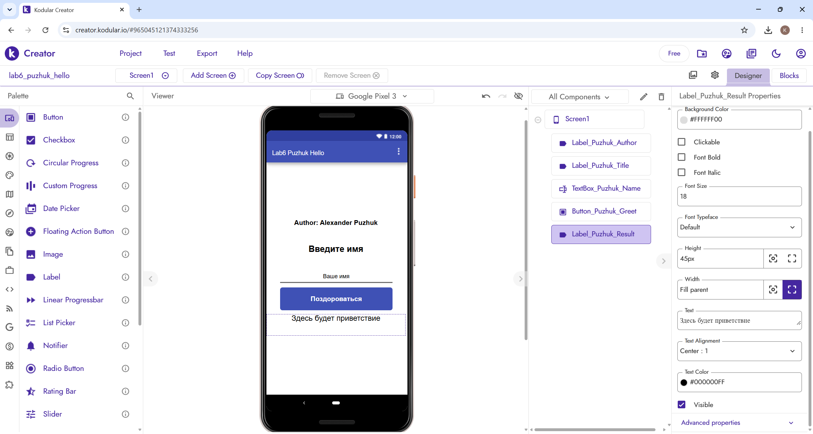
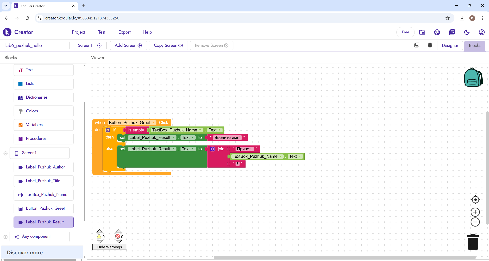
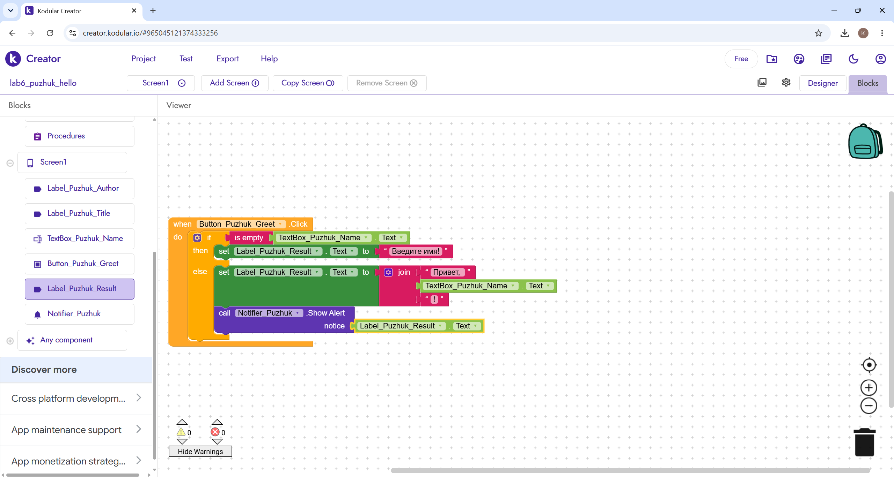

# Лабораторная работа №6. Kodular

**Студент:** Пужук Александр (`Puzhuk`)  
**Проект в Kodular:** `lab6_puzhuk_hello`  
**Экспортированный проект:** [`lab6-puzhuk.aia`](../exports/lab6-puzhuk.aia)

---

## 1. Краткое описание базового приложения и дополнительных возможностей

### Базовое приложение «Приветствие» (`lab6_puzhuk_hello`)
В среде визуального программирования **Kodular Creator** разработано мобильное приложение под ОС Android, реализующее интерактивное приветствие пользователя с проверкой корректности ввода.

На главном экране **`Screen1`** (заголовок экрана `Lab6 Puzhuk Hello`, выравнивание по горизонтали и вертикали — по центру) размещены следующие визуальные компоненты:
1. **`Label_Puzhuk_Author`** — текстовая метка с указанием автора работы (`Author: Alexander Puzhuk`), подтверждающая уникальность выполнения.
2. **`Label_Puzhuk_Title`** — заголовок формы ввода с текстом `«Введите имя»`.
3. **`TextBox_Puzhuk_Name`** — поле ввода имени пользователя со свойством `Hint = «Ваше имя»`.
4. **`Button_Puzhuk_Greet`** — кнопка действия с текстом `«Поздороваться»` (оформлена со скруглёнными краями `Shape = rounded`).
5. **`Label_Puzhuk_Result`** — текстовая метка для вывода результата или сообщения об ошибке (начальный текст: `«Здесь будет приветствие»`).

**Логика базового приложения:**
При нажатии на кнопку `Button_Puzhuk_Greet` срабатывает обработчик события `when Button_Puzhuk_Greet.Click`:
* С помощью условного блока `if / then / else` и строкового блока `is empty` проверяется свойство `TextBox_Puzhuk_Name.Text`.
* **Ветка `then` (поле пустое):** свойству `Label_Puzhuk_Result.Text` присваивается строка `«Введите имя!»`.
* **Ветка `else` (имя введено):** с помощью блока конкатенации `join` из 3 входов формируется строка из префикса `"Привет, "`, введённого имени `TextBox_Puzhuk_Name.Text` и знака `"!"`, которая выводится в `Label_Puzhuk_Result.Text`.

---

### Дополнительные возможности (Ачивки)

#### Ачивка 8: Уведомления (Notifier)
* **Описание функционала:** После успешного ввода имени и формирования текста приветствия приложение показывает пользователю всплывающее системное Toast-уведомление с текстом приветствия. Если текстовое поле пустое, всплывающее уведомление не вызывается.
* **Использованные компоненты:** Невидимый компонент **`Notifier`** (переименован в `Notifier_Puzhuk`) из палитры `User Interface`.
* **Использованные блоки:**
  * Вызов метода `call Notifier_Puzhuk.ShowAlert (notice)`, размещённый внутри ветки `else` блока `if / then / else` сразу после обновления текста `Label_Puzhuk_Result`.
  * Блок чтения свойства `Label_Puzhuk_Result.Text`, переданный во входной параметр `notice`.

---

## 2. Ссылка на проект / Экспорт

Исходный архив проекта экспортирован из Kodular Creator в формате `.aia` и сохранён в репозитории:
* Файл проекта: [`lab6/exports/lab6-puzhuk.aia`](../exports/lab6-puzhuk.aia)

---

## 3. Использованные AI-промпты

В ходе выполнения работы применялись следующие ключевые промпты к ИИ-ассистенту:

1. **Построение базовой логики проверки пустого поля:**
   > *«Как в Kodular сделать так, чтобы при нажатии на кнопку проверялось, пустое ли текстовое поле TextBox, и в зависимости от этого в Label выводилась ошибка или приветствие?»*
2. **Исправление вёрстки и переноса кириллического текста в веб-превью:**
   > *«Почему в Kodular Designer заголовок Label на русском языке переносится на вторую строку и налезает на TextBox снизу? Какие свойства Width и Text Alignment нужно выставить?»*
3. **Поиск ошибки в блоках (предупреждение в редакторе Blocks):**
   > *«В редакторе блоков Kodular появилось предупреждение в блоке if is empty. Куда правильно подключить свойство TextBox.Text и как изменить целевой компонент в блоке set Text to?»*
4. **Реализация всплывающего уведомления (Notifier):**
   > *«Как в Kodular добавить компонент Notifier и вызвать всплывающее Toast-уведомление (ShowAlert) только при успешном прохождении проверки if/else?»*

---

## 4. Освоенные компоненты и блоки Kodular

### Компоненты (Designer):
* **`Screen`** (`Screen1`) — настройка выравнивания контейнера (`Align Horizontal = Center`, `Align Vertical = Center`), заголовок окна (`Title`).
* **`Label`** (`Label_Puzhuk_Author`, `Label_Puzhuk_Title`, `Label_Puzhuk_Result`) — отображение статического и динамического текста, настройка ширины `Fill parent`, высоты в пикселях, центрирования (`Text Alignment = Center`) и шрифта (`Font Bold`, `Font Size`).
* **`TextBox`** (`TextBox_Puzhuk_Name`) — ввод пользовательского текста, настройка подсказки (`Hint`) и относительной ширины (`Width = 80%`).
* **`Button`** (`Button_Puzhuk_Greet`) — интерактивная кнопка, кастомизация цвета фона (`Background Color`), цвета текста (`Text Color`) и формы (`Shape = rounded`).
* **`Notifier`** (`Notifier_Puzhuk`) — невидимый системный компонент (`Non-visible component`) для вывода всплывающих оповещений и диалоговых окон.

### Блоки (Blocks):
* **События (Events):** `when Button_Puzhuk_Greet.Click do` — обработка клика по кнопке.
* **Управление потоком (Control):** `if / then / else` — условное ветвление логики; модификация структуры блока через мутатор (шестерёнку).
* **Работа со строками (Text):**
  * `is empty` — проверка строки на пустоту;
  * `join` — конкатенация (склеивание) нескольких строк с расширением количества входов до 3 через мутатор;
  * строковые литералы `" "`.
* **Свойства компонентов (Getters / Setters):**
  * чтение значения `TextBox_Puzhuk_Name.Text` и `Label_Puzhuk_Result.Text`;
  * запись значения `set Label_Puzhuk_Result.Text to`.
* **Вызовы процедур компонентов (Methods):** `call Notifier_Puzhuk.ShowAlert (notice)` — показ всплывающего уведомления.

---

## 5. Скриншоты экранов и логики

### 1. Экран дизайнера (`Screen1`) с видимой фамилией и свойствами компонентов

### 2. Блоки базовой логики (`if / else`, `is empty`, `join`)

### 3. Реализация Ачивки 8: Уведомления (`Notifier.ShowAlert`)

---

## 6. Ограничения бесплатного тарифа Kodular Free

При работе на бесплатном тарифе (**Kodular Free**) действуют следующие ограничения платформы:
1. **Лимит проектов:** максимум до **10 проектов** на одном аккаунте.
2. **Лимит медиафайлов (Assets):** общий объём загружаемых ассетов ограничен **10 МБ** (и не более 5 МБ на один проект).
3. **Лимит расширений (Extensions):** можно подключить не более **5 сторонних расширений (`.aix`)** в проекте.
4. **Ограничения монетизации и сборки:** при использовании рекламных компонентов взимается комиссия платформы.

В рамках данной лабораторной работы указанные лимиты не помешали реализации функционала, так как приложение использует только встроенные компоненты и не требует тяжёлых медиафайлов.

---

## 7. Выводы

В ходе выполнения лабораторной работы была освоена low-code/no-code платформа **Kodular Creator** для визуальной разработки мобильных приложений под Android. Я научился проектировать пользовательский интерфейс в режиме *Designer*, настраивать адаптивное выравнивание и размеры компонентов, а также реализовывать событийно-ориентированную логику в редакторе *Blocks* с использованием условных операторов (`if/else`), строковых функций (`is empty`, `join`) и системных уведомлений (`Notifier`). Визуальное блочное программирование позволяет очень быстро создавать рабочие прототипы мобильных приложений без написания шаблонного кода на Java/Kotlin, однако требует внимательности при настройке вёрстки и привязке блоков свойств.
