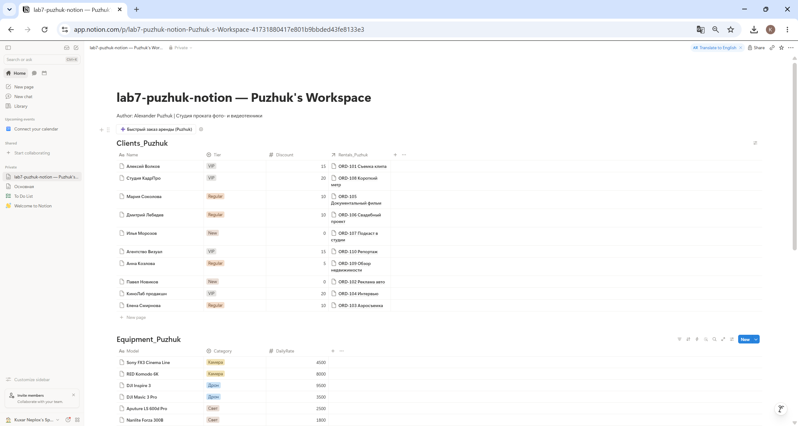
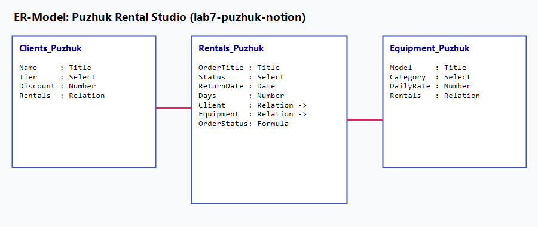
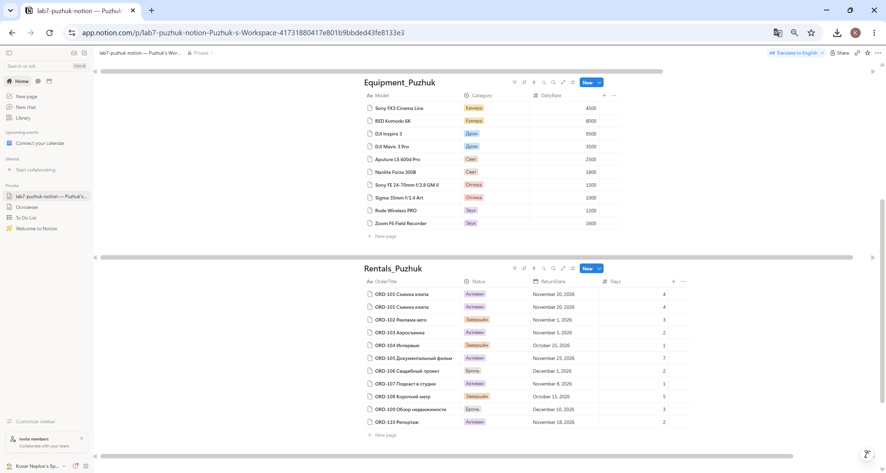
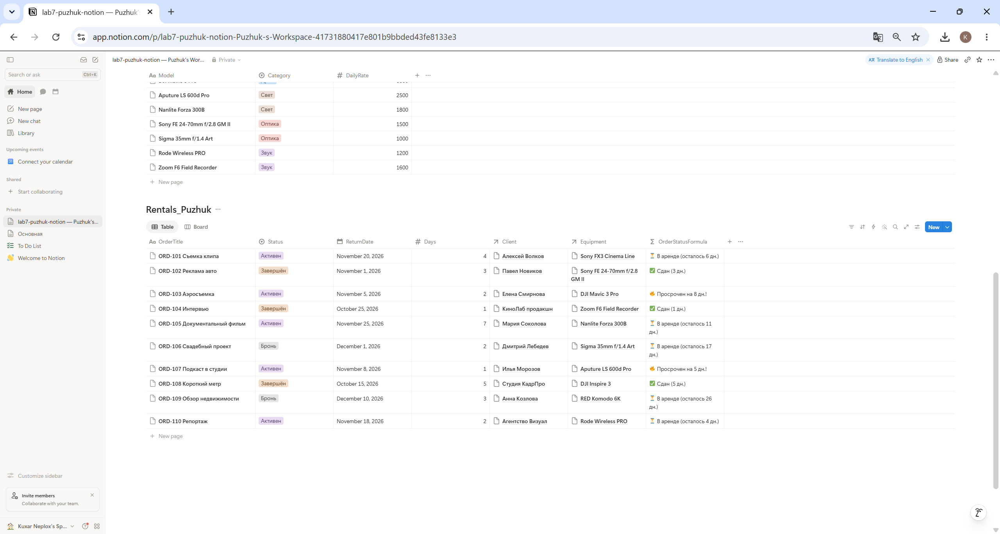

# Лабораторная работа №7. Notion

**Студент:** Пужук Александр (`Puzhuk`)  
**Рабочее пространство:** `lab7-puzhuk-notion — Puzhuk's Workspace`  
**Ссылка на опубликованную страницу Notion:** [Открыть опубликованный Workspace](https://statuesque-bass-37b.notion.site/lab7-puzhuk-notion-Puzhuk-s-Workspace-41731880417e801b9bbded43fe8133e3)  
**Экспортированный файл:** [`lab7/exports/lab7-puzhuk.md`](../exports/lab7-puzhuk.md)

---

## 1. Краткое описание сгенерированной предметной области и модели данных

В рамках лабораторной работы с помощью ИИ-ассистента была спроектирована и реализована в **Notion** информационная система **«Студия проката фото- и видеотехники (`Puzhuk Rental Studio`)»**.

Модель данных состоит из **3 связанных сущностей (отдельных баз данных Notion)**:
1. **`Clients_Puzhuk` (Клиенты)** — справочник клиентов и продакшн-студий с категоризацией по уровню лояльности (`Tier`: `VIP`, `Regular`, `New`) и персональной скидкой (`Discount`).
2. **`Equipment_Puzhuk` (Оборудование)** — каталог сдаваемой в аренду техники (кинокамеры, дроны, свет, звук, оптика) с указанием категории (`Category`) и суточной стоимости проката (`DailyRate`).
3. **`Rentals_Puzhuk` (Заказы на аренду)** — центральная операционная таблица заказов, содержащая статус заказа (`Status`: `Активен`, `Бронь`, `Завершён`), дату возврата (`ReturnDate`), длительность аренды в днях (`Days`), две двусторонние связи `Relation` с таблицами клиентов (`Client`) и оборудования (`Equipment`), а также вычисляемое свойство `OrderStatusFormula` (`Formula`).

Каждая из трёх баз данных наполнена **10 реалистичными записями**. Для базы `Rentals_Puzhuk` настроены **два представления (Views)**:
* **`Table`** — полная таблица со всеми атрибутами, связями и расчётами формулы;
* **`Board`** — Канбан-доска с группировкой карточек заказов по свойству `Status` (`Активен`, `Бронь`, `Завершён`).

На главной странице также размещена интерактивная кнопка **`+ Быстрый заказ аренды (Puzhuk)`** (`Button`), автоматически создающая новую запись в базе `Rentals_Puzhuk` с предзаполненным статусом `Активен`.

---

## 2. Промпт для ИИ, ответ ИИ и внесённые исправления

### Промпт, переданный ИИ:
> *«Придумай уникальную предметную область для учебного проекта в Notion (сервис проката фото- и видеооборудования). Нужно 3 связанные сущности (базы данных), минимум 2 связи типа Relation между ними, у каждой сущности не менее 3 свойств. Суммарно используй типы свойств: Title, Select, Date, Number, Relation, Formula. Опиши схему данных, объясни назначение каждой связи и напиши сложную формулу Notion (Formula 2.0) с использованием if, конкатенации строк и функций работы с датами».*

### Сгенерированная схема (ответ ИИ):

| База данных (Сущность) | Свойство (Поле) | Тип свойства в Notion | Описание |
| :--- | :--- | :--- | :--- |
| **1. `Clients_Puzhuk`** | `Name` | `Title` | ФИО клиента или название продакшн-студии |
| | `Tier` | `Select` | Уровень клиента (`VIP`, `Regular`, `New`) |
| | `Discount` | `Number` | Персональная скидка клиента (%) |
| | `Rentals_Puzhuk` | `Relation` | Двусторонняя связь с базой заказов |
| **2. `Equipment_Puzhuk`** | `Model` | `Title` | Наименование камеры, дрона или объектива |
| | `Category` | `Select` | Категория (`Камера`, `Дрон`, `Свет`, `Звук`, `Оптика`) |
| | `DailyRate` | `Number` | Стоимость аренды за 1 сутки (руб.) |
| | `Rentals_Puzhuk` | `Relation` | Двусторонняя связь с базой заказов |
| **3. `Rentals_Puzhuk`** | `OrderTitle` | `Title` | Номер и название заказа (`ORD-101 ...`) |
| | `Status` | `Select` | Статус заказа (`Активен`, `Завершён`, `Бронь`) |
| | `ReturnDate` | `Date` | Плановая дата возврата техники |
| | `Days` | `Number` | Количество дней аренды |
| | `Client` | `Relation` | **Связь №1:** ссылка на запись в `Clients_Puzhuk` |
| | `Equipment` | `Relation` | **Связь №2:** ссылка на запись в `Equipment_Puzhuk` |
| | `OrderStatusFormula` | `Formula` | Вычисляемый статус дедлайна (с `if`, датами и конкатенацией) |

### Что было исправлено и уточнено после проверки:
1. **Добавление уникального идентификатора студента:** в названия главной страницы, кнопки и всех трёх баз данных добавлена фамилия `Puzhuk` (`Clients_Puzhuk`, `Equipment_Puzhuk`, `Rentals_Puzhuk`).
2. **Включение двусторонних связей (`Two-way relation`):** при настройке свойств `Client` и `Equipment` в базе `Rentals_Puzhuk` была активирована опция `Show on Clients_Puzhuk` и `Show on Equipment_Puzhuk`, чтобы в таблицах клиентов и техники автоматически отображались привязанные заказы.
3. **Улучшение формулы для отрицательных значений просрочки:** в функцию расчёта просроченных дней добавлен вызов `abs()`, чтобы вместо отрицательного числа (`-8 дн.`) выводилась читаемая строка `🔥 Просрочен на 8 дн.!`.

---

## 3. Перечень реализованных дополнительных возможностей (Ачивок)

### Ачивка 8: Сложная формула
* **Описание функционала:** В базе данных `Rentals_Puzhuk` создано вычисляемое свойство **`OrderStatusFormula`** типа `Formula`, которое анализирует текущий статус заказа и плановую дату возврата оборудования относительно сегодняшней даты (`now()`), формируя наглядное текстовое уведомление с эмодзи.
* **Использованный код формулы (Notion Formula 2.0):**

    if(prop("Status") == "Завершён", "✅ Сдан (" + format(prop("Days")) + " дн.)", if(dateBetween(prop("ReturnDate"), now(), "days") < 0, "🔥 Просрочен на " + format(abs(dateBetween(prop("ReturnDate"), now(), "days"))) + " дн.!", "⏳ В аренде (осталось " + format(dateBetween(prop("ReturnDate"), now(), "days")) + " дн.)"))

* **Какие настройки и функции использованы:**
  * Вложенное условное выражение **`if(условие, истина, ложь)`** — сначала проверяет, завершён ли заказ (`prop("Status") == "Завершён"`), а если нет — проверяет, наступил ли дедлайн возврата;
  * Функции работы с датами **`now()`** и **`dateBetween(prop("ReturnDate"), now(), "days")`** — вычисляют разницу в днях между датой возврата и текущим моментом;
  * Математическая функция **`abs()`** — берёт модуль отрицательного числа дней при просрочке;
  * Приведение типов **`format()`** и **конкатенация строк (`+`)** — склеивают числовые значения с текстовыми пояснениями и индикаторами (`✅ Сдан`, `🔥 Просрочен`, `⏳ В аренде`).

---

## 4. Ссылка на опубликованную страницу и экспорт

* **Опубликованная страница в веб (Share → Publish to web):**  
  👉 [https://statuesque-bass-37b.notion.site/lab7-puzhuk-notion-Puzhuk-s-Workspace-41731880417e801b9bbded43fe8133e3](https://statuesque-bass-37b.notion.site/lab7-puzhuk-notion-Puzhuk-s-Workspace-41731880417e801b9bbded43fe8133e3)
* **Локальный экспорт в репозитории:** [`lab7/exports/lab7-puzhuk.md`](../exports/lab7-puzhuk.md)

---

## 5. Ключевые AI-промпты, использованные в работе

1. **Проектирование ER-модели и схемы баз данных:**
   > *«Придумай уникальную предметную область для учебного проекта в Notion (прокат видеотехники) с 3 связанными таблицами, минимум двумя связями Relation и типами полей Title, Select, Date, Number, Formula».*
2. **Генерация тестовых наборов данных для быстрой вставки:**
   > *«Сгенерируй по 10 реалистичных записей для таблиц Clients_Puzhuk, Equipment_Puzhuk и Rentals_Puzhuk в формате Markdown-таблиц для копирования в Notion».*
3. **Разработка сложной формулы с датами и условиями (Ачивка 8):**
   > *«Напиши формулу Notion (Formula 2.0), которая проверяет поле Status, считает количество оставшихся или просроченных дней до ReturnDate через dateBetween и now(), и склеивает результат в строку со смайликами».*
4. **Настройка автоматизации через кнопку (`Button`):**
   > *«Как в Notion настроить блок Button так, чтобы при нажатии автоматически добавлялась новая страница в базу данных Rentals_Puzhuk с заполненным заголовком и статусом Активен?»*

---

## 6. Освоенные компоненты и настройки Notion

* **Встроенные базы данных (`Inline Databases`):** создание отдельных таблиц на одной рабочей странице.
* **Типы свойств (`Properties`):**
  * `Title` — ключевое имя записи;
  * `Select` — теги с цветовой кодировкой (`VIP/Regular/New`, категории техники, статусы заказа);
  * `Number` — числовые поля (скидки, стоимость аренды, количество дней);
  * `Date` — календарные даты возврата оборудования;
  * `Relation` — двусторонние реляционные связи (`Two-way relation`) между тремя таблицами;
  * `Formula` — вычисляемые столбцы на базе языка выражений Notion Formula 2.0.
* **Представления (`Views`):** настройка табличного вида (`Table view`) и Канбан-доски (`Board view`) с группировкой по свойству `Status`.
* **Интерактивные блоки (`Button`):** создание кнопки автоматизации с действием `Add page to...` и предзаполнением свойств.
* **Параметры страницы и публикации:** широкоформатный режим (`Full width`), публикация рабочего пространства в веб (`Share → Publish`).

---

## 7. Скриншоты экранов и настроек

### 1. Главная страница (`Puzhuk's Workspace`), кнопка `Button` и таблица `Clients_Puzhuk` со связями

### 2. Схема модели данных и связей (`ER-Model`)

### 3. Представление Канбан-доски (`Board view`) для базы `Rentals_Puzhuk` и таблица `Equipment_Puzhuk`

### 4. Связи `Relation` (`Client`, `Equipment`) и результат работы Сложной формулы (`Ачивка 8`) в `Rentals_Puzhuk`

---

## 8. Ограничения бесплатного тарифа Notion (Free Plan)

В процессе работы на бесплатном персональном тарифе **Notion Free** были учтены следующие ограничения платформы:
1. **Ограничение на размер загружаемых файлов:** максимум до **5 МБ** на один загружаемый файл.
2. **История версий страницы (`Page history`):** доступна только за последние **7 дней** (на платных тарифах — от 30 дней и выше).
3. **Ограничения автоматизаций в базах данных (`Database Automations`):** на бесплатном плане нельзя создавать сложные триггерные автоматизации внутри самой базы (доступны только шаблоны и кнопочные блоки `Button` на странице).
4. **Ограничение приглашённых гостей:** до 10 гостей в рабочем пространстве.

---

## 9. Выводы

В ходе выполнения лабораторной работы №7 я освоил платформу **Notion** как low-code/no-code инструмент для проектирования реляционных баз данных и управления проектами. С помощью ИИ-ассистента была разработана и проверена трёхуровневая модель данных для сервиса проката оборудования, реализованы двусторонние связи `Relation`, настроены табличное и Канбан-представления (`Table` и `Board`), кнопка быстрого создания заказа (`Button`), а также написана сложная вложенная формула с расчётом дат и конкатенацией строк. Сочетание генерации схемы через ИИ и гибких возможностей Notion позволяет за считанные минуты развернуть полноценную CRM/ERP-систему без написания серверного кода.
